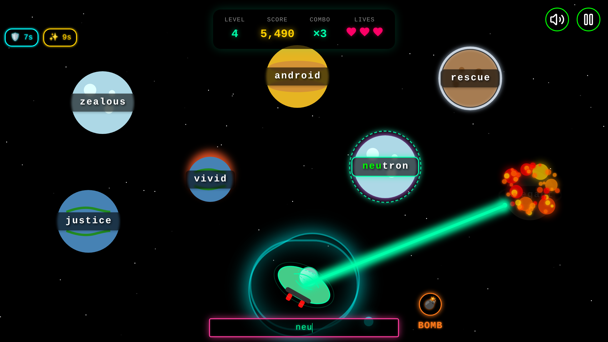

# Word Blast 🚀

A fast-paced typing game where you defend Earth from alien words by typing them correctly. Blast aliens with your laser typing skills and collect power-ups to help you survive the invasion!

<p align="center">
  <a href="https://youtu.be/your-video-id">
    
  </a>
  <br>
  <em>Click the image to watch the gameplay demo</em>
</p>

## 🎮 Play Now!

You can play Word Blast right now in your browser:
[**Play Word Blast**](https://word-blast-game.vercel.app/)

## ✨ Features

- **Fast-paced Typing Action**: Type a word to lock on to its planet and blast it before it reaches your ship
- **Four Difficulty Modes**: Easy, Normal, Hard, and a Zen practice mode with no lives and no game over
- **Combo Multiplier**: Chain kills without a typo or a miss to multiply your score up to ×5
- **Enemy Types**: Fast planets, armoured planets that take two words, and splitters that break into two
- **Boss Fights**: Every fifth level ends with a boss you defeat by typing a whole phrase
- **Six Power-ups**: Shield, slow time, freeze, double score, bomb and extra life
- **Typing Stats**: Words per minute, accuracy and best combo after every game, plus a top-ten high-score table
- **Plays on Phones**: The layout adapts to small screens and on-screen keyboards
- **Settings**: Volume control and a reduced-motion option that turns off shake and flashing

## 🎮 How to Play

1. **Pick a difficulty** and press "Start Game"
2. **Type words**: the first letter locks on to a planet, and finishing the word destroys it
3. **Fix mistakes**: wrong letters are rejected, so just keep typing. Press Space or Enter to let go of a target and pick another
4. **Protect your ship**: every planet that reaches it costs a life and resets your combo
5. **Collect power-ups** by typing the word under them:
   - 🛡️ **SHIELD**: planets that reach you do no damage
   - ⏰ **SLOW**: everything falls at less than half speed
   - ❄️ **FREEZE**: planets stop completely for a few seconds
   - ✨ **DOUBLE**: double score
   - 💣 **BOMB**: destroys every planet on screen
   - ❤️ **LIFE**: one extra life, up to five
6. **Beat the boss**: every fifth level, type its phrase word by word before it lands
7. **Pause** with Esc

## 🚀 Getting Started

Word Blast is a static site with no build step and no dependencies. To run it locally, open `index.html` in your browser, or serve the folder:

```bash
# Clone the repository
git clone https://github.com/yourusername/word-blast.git
cd word-blast

# Serve the folder with any static file server
python3 -m http.server 8000
```

Open http://localhost:8000 in your browser to see the game in action.

## 🛠️ Technologies Used

- HTML - A single page, no framework
- CSS - Styling, animations and visual effects
- JavaScript - Game loop, state and DOM rendering
- HTML Audio and Web Audio - For sound effects and background music

## 🔧 Project Structure

    word-blast/
    ├── index.html    # Page markup for every screen
    ├── styles.css    # All styling and animations
    ├── js/
    │   ├── main.js       # Game state, rules and main loop
    │   ├── view.js       # DOM builders (planets, lasers, effects)
    │   ├── config.js     # Difficulty modes, tuning values, level formulas
    │   ├── words.js      # Word tiers and boss phrases
    │   ├── sound.js      # Sound files, synthesized effects, volume
    │   └── highscore.js  # High scores and settings in localStorage
    └── sounds/       # Game sound effects

## 🤝 Contributing

Contributions are welcome! If you'd like to contribute:

1. Fork the repository
2. Create a feature branch ( git checkout -b feature/amazing-feature )
3. Commit your changes ( git commit -m 'Add some amazing feature' )
4. Push to the branch ( git push origin feature/amazing-feature )
5. Open a Pull Request

## 📝 License

This project is licensed under the MIT License - see the LICENSE file for details.
